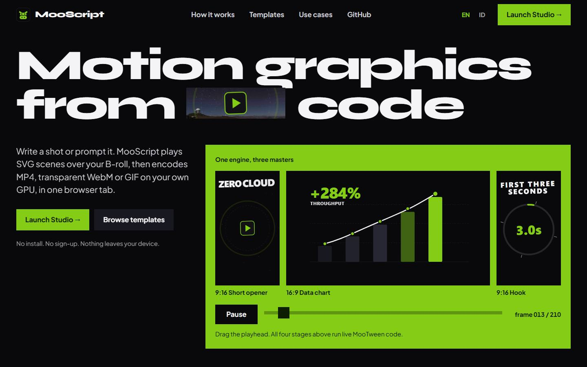
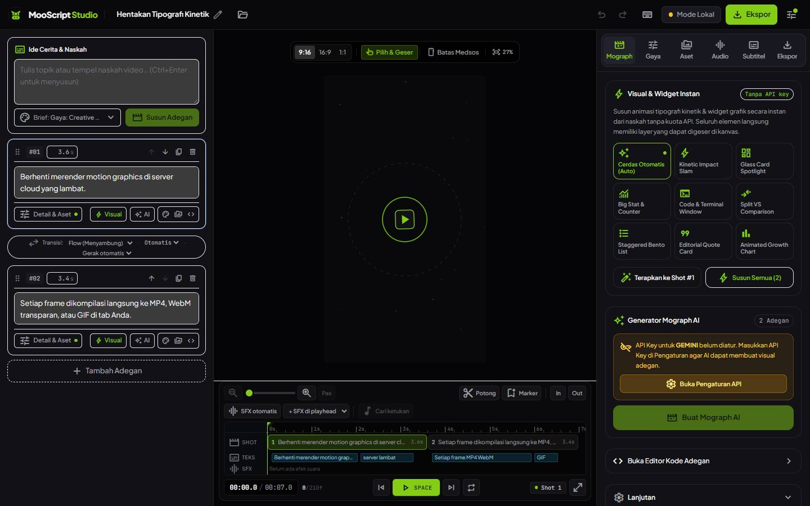
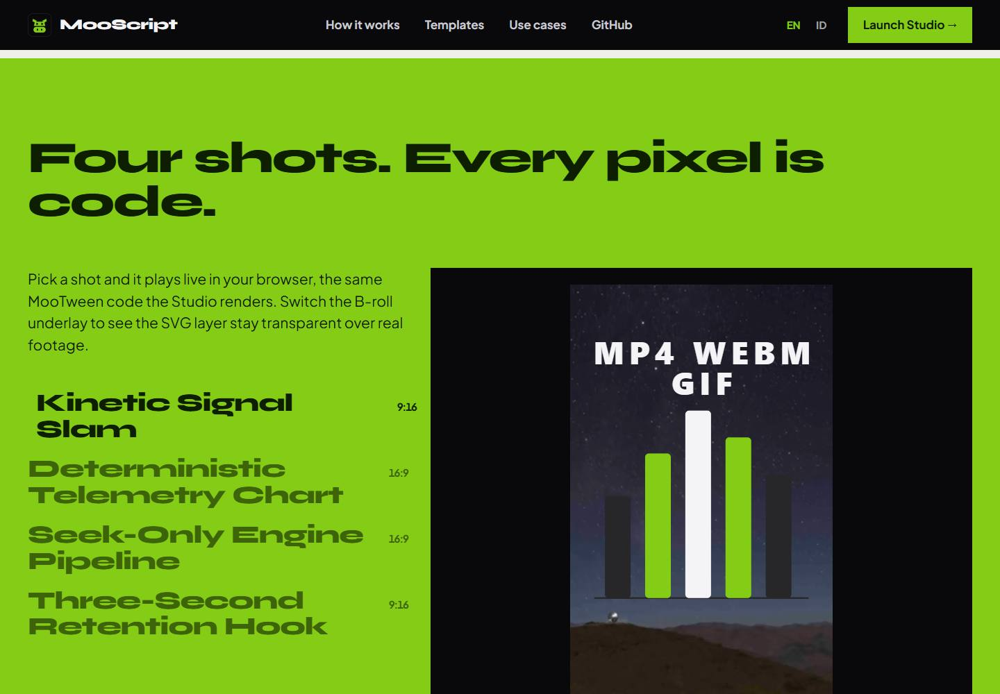
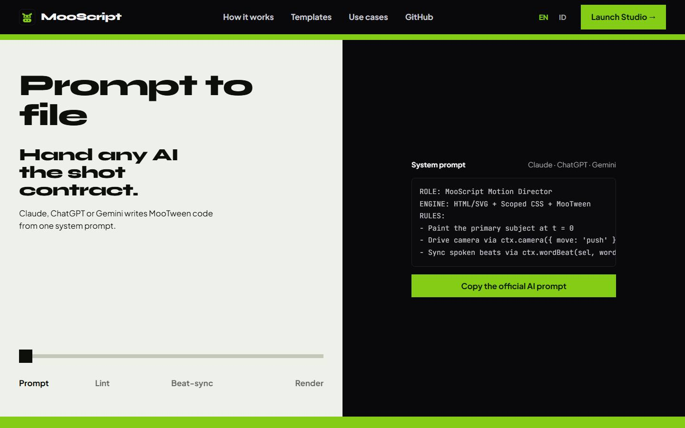
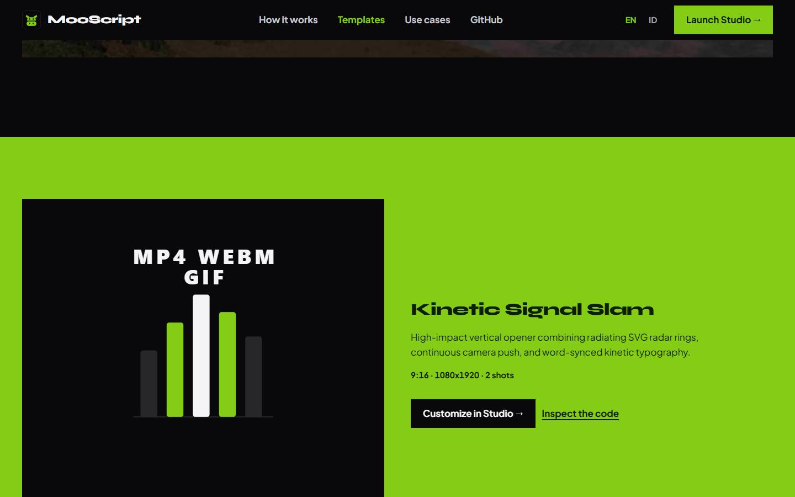
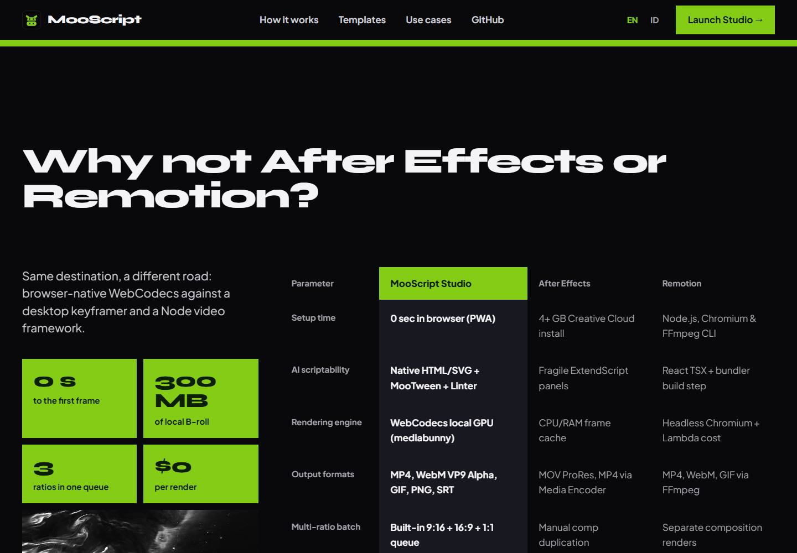
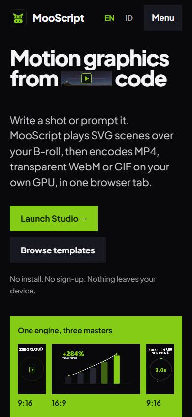

# MooScript

> Turn a topic or a script into a motion graphics video, entirely in the browser. An AI motion director writes each shot as SVG + CSS + a MooTween track, a sandboxed runtime plays it as one continuous film, and WebCodecs exports the MP4 on your own device. No server, no account, bring your own API key.

[](https://github.com/hernataramadhan79-bit/MooScript/actions/workflows/ci.yml)
[](LICENSE)

**Studio:** [app.mooscript.web.id](https://app.mooscript.web.id) · **Website:** [mooscript.web.id](https://mooscript.web.id) · **Languages:** English and Bahasa Indonesia



---

## Preview

### MooScript Studio

The workstation: storyboard on the left, the stage and master timeline in the middle, and the inspector rack (Mograph, Style, Assets, Audio, Subtitles, Export) on the right. The interface is in Bahasa Indonesia.



### Website (`apps/web`)

The landing site is built to look like the product: poster typography, whole fields of colour, and stages that run the real MooTween code the Studio renders.

| | |
| :-- | :-- |
|  |  |
| **Showcase.** Pick a shot and it plays live. Switch the B-roll underlay to see the SVG layer stay transparent over footage. | **How it works.** One slider walks through prompt, linter, beat-sync and the export queue. |
|  |  |
| **Templates.** Every preset plays live next to its code and a deep link into the Studio. | **Comparison.** MooScript against After Effects and Remotion. |

<p align="center">
  
</p>

---

## What it does

1. **Write an idea or a script.** The AI turns it into a **shot list** (5–10 shots of 2–4.5 s), each with one hero object and a match cut into the next shot, plus a **world bible** for the whole film: palette, a recurring motif, illustration style and camera style.
2. **Generate the visuals.** Each shot is written as real motion graphics code (SVG-first stage, a moving camera, kinetic type) and checked by an anti-slide linter before it lands on the timeline.
3. **Add a voice-over and music.** Cloud or fully offline TTS, Whisper word alignment, procedural background music with speech ducking.
4. **Edit and export.** Drag layers on the canvas, tweak colors, edit the code of any shot, then export MP4 (plus SRT/VTT subtitles) locally.

Projects start empty. Everything is stored in your browser (IndexedDB).

---

## Features

### AI motion director

- **Shot-list storyboard + world bible** (`apps/studio/src/engine/ai/llm.ts`): structured output for Gemini, OpenAI, Groq, Anthropic and OpenRouter. The world bible palette becomes the project theme.
- **Stage contract & motion grammar** (`apps/studio/src/engine/ai/director/motionLaws.ts`): each shot is a fixed film frame (1080×1920, 1920×1080 or 1080×1080) composed in absolute coordinates inside a `.moo-camera` layer. Frame 0 must already show the subject, nothing holds still for long, accents land on spoken words, and every shot ends with a hand-off.
- **Shot continuity**: every shot prompt carries the world bible, its neighbouring shots and the incoming/outgoing match cut.
- **Anti-PPT linter** (`apps/studio/src/engine/composition/mographLint.ts`): scores generated code for slide/web-page patterns (no camera, card layouts, pasted narration, fade-up-only motion, empty first frame, …) and requests one rewrite when needed. The rewrite is kept only if it is valid and scores better.
- **Mograph kit** (`apps/studio/src/engine/composition/runtime/mographKit.ts`): helpers on `ctx` that generated code calls instead of hand-rolled tweens — `ctx.camera`, `ctx.hero`, `ctx.draw`, `ctx.pop`, `ctx.kinetic`, `ctx.count`, `ctx.reveal`, `ctx.punch`, `ctx.shake`, `ctx.flash`, `ctx.drift`, `ctx.orbit`, `ctx.particles`, `ctx.beat`. All stay inside the shot duration and are deterministic.
- **Instant visuals without AI** (`apps/studio/src/engine/composition/proceduralCompiler.ts`): eight procedural archetypes with camera moves, particles and hand-offs.

### Composition runtime

- Sandboxed iframe stage (`apps/studio/src/engine/composition/buildDocument.ts`, `runtime/mooRuntime.ts`) with a single MooTween master track scrubbed by frame, so preview and export are identical.
- Each shot's selectors only match inside that shot, and `loop: true` repeats for the length of the shot.
- **Flow transition** (default): the next shot already waits underneath, held at its first frame, while the current one hands off and dissolves; its own camera move is the first motion it makes, so shot starts never stutter. Cut, fade, slide, zoom and wipe are also available.
- Per-scene CSS is scoped to its wrapper (`scopeCss.ts`), so shots never leak styles into each other.
- Poster frames: while the editor is paused at the start of a shot whose first frame is empty, the preview shows its first frame with content. Playback and export always render the real timeline.
- Non-destructive layer overrides (move, scale, rotate, opacity, color) and per-scene palettes.

### MooTween, the animation engine

MooTween (`apps/studio/src/engine/composition/runtime/mooTween.ts`) is MooScript's own animation engine. It is seek-only: nothing runs on a real-time ticker, and every frame is produced by `seek(t)`, so the same time always renders the same picture in the editor, the MP4 and the HTML export.

- Scenes use MooScript's own API (see [Writing scene code](#writing-scene-code) below). The AI director is taught the same guide, and the scene code editor has it in the **Panduan API** tab.
- Code in another API (`tl.to`, `gsap.*`, `duration:`, `ease: 'power2.out'`, plugins, …) is rejected for new scenes with the MooScript replacement. Saved scenes that use it are marked **perlu perbaikan** and can be fixed with **Perbaiki dengan AI** in the scene inspector; their code is never rewritten without asking.
- A golden-frame suite (`apps/studio/tests/golden/`) renders 46 reference shots in Chromium and compares every frame with snapshots recorded from the previous engine.

### Writing scene code

A scene is three blocks: HTML, CSS and JavaScript. The JavaScript runs once, as a function of `(shot, root, ctx, MooTween)`, and only places moves on the shot; MooTween plays them by seeking. Do not redeclare those four names. The guide lives in [`runtime/mooApiGuide.ts`](apps/studio/src/engine/composition/runtime/mooApiGuide.ts), which feeds the AI prompt, the **Panduan API** tab and a test that checks this section lists every name.

| Name | What it is |
| --- | --- |
| `shot` | This shot's track. Every move goes here. |
| `root` | The shot's wrapper element. String selectors only match inside it. |
| `ctx` | Motion helpers (`ctx.camera`, `ctx.hero`, …) and shot info: `ctx.dur`, `ctx.stage`, `ctx.rand()`. |
| `MooTween` | The engine: `MooTween.track()` for sub-tracks, `MooTween.math`, `MooTween.select()`. |

**Moves.** A target is a selector string, an element, a NodeList, an array, or a plain object (for counters). Every method returns the track, so calls chain.

| Method | Does |
| --- | --- |
| `shot.go(target, props, at)` | Moves from the current state to `props`. |
| `shot.arrive(target, props, at)` | Moves from `props` to the current state. The start state shows at once. |
| `shot.travel(target, from, to, at)` | Moves from one set of props to another. The start state shows at once. |
| `shot.pin(target, props, at)` | Sets props instantly at `at`, and undoes them when the playhead goes back past it. |
| `shot.mark('hit', at)` | Names a time so other moves can use `'hit'` or `'hit+0.2'`. |
| `shot.cue(fn, at)` | Calls `fn(progress)` when the playhead crosses `at`, forwards or backwards. |
| `shot.nest(sub, at)` | Places a sub-track (`const sub = MooTween.track(); sub.go(...)`) inside the shot. |

**Time (`at`)**, the last argument: a number of seconds; `'end'`, `'end+0.3'`, `'end-0.3'` (the end of everything placed so far, the default); `'with'`, `'with+0.2'` (with the start of the previous move); `'after'`, `'after-0.1'` (after the previous move ends); a mark name such as `'hit+0.1'`; or `ctx.beat('word', 1.2)` for the moment a word is spoken in the voice-over.

**Options**, written next to the animated props:

| Option | Does |
| --- | --- |
| `dur: 0.6` | Length in seconds (default 0.5). |
| `wait: 0.2` | Starts that much after `at`. |
| `curve: 'rush-out'` | The easing curve (default `'soft-out'`). |
| `cascade: 0.08` or `{ gap \| total, from }` | Offsets several targets; `from`: `'first'`, `'middle'`, `'last'`, `'ends'`, an index or `'shuffle'`. |
| `loop: 2` / `loop: true`, `pingpong: true`, `loopGap: 0.3` | Repeats (`true` = for the whole shot), going back and forth, with a gap. |
| `sequence: [{ x: 80, dur: 0.3 }, { y: 40 }]` | Steps on the same target, linear unless a step has a curve. |
| `showStart: false` | For `arrive` / `travel`: don't show the start state before the move begins. |
| `onBegin` / `onFrame` / `onEnd` | `fn(progress)` when the move starts, on every frame, and when it ends. |
| `round: { v: 1 }` | Rounds a value to a step (handy for counters). |

**Properties**: `x`, `y` (px or `'50%'`), `shiftX` / `shiftY` (percent of the element's size), `scale`, `scaleX`, `scaleY`, `spin` (degrees), `tiltX` / `tiltY` with `depth` (3D, perspective in px), `skewX` / `skewY`, `pivot: '50% 100%'` (transform origin), `pivotPoint: '540 960'` (SVG origin in viewBox units), `opacity` and `fade` (also hides the element at 0), numeric CSS (`width`, `fontSize`, `borderRadius`, …), colors (`color`, `backgroundColor`, `fill`, `stroke`: hex, rgb, hsl, names, `var(--moo-accent)`), `clipPath` / `filter` / `boxShadow`, `strokeDasharray` / `strokeDashoffset`, and SVG attributes as `attrs: { cx, r, d }`. Relative values are written `'by(40)'` or `'by(-0.5)'`.

**Curves** are written `name-direction`, where the direction is `-in`, `-out` (the default) or `-inout`: `linear`, `soft`, `smooth`, `strong`, `sharp` (from gentle to steep acceleration), `gentle`, `rush` (fast, then a hard brake), `arc`, `overshoot-out(1.7)`, `spring-out(1, 0.3)` (amplitude, period), `bounce-out` and `steps(5)`.

**ctx helpers** place their own moves and keep everything inside `[0, ctx.dur]`: `ctx.camera({ move, handoff })`, `ctx.handoff('zoom')`, `ctx.hero(target)`, `ctx.draw(paths, { at, dur, cascade })`, `ctx.pop(targets, { at, cascade })`, `ctx.kinetic(el, { style, by, at })`, `ctx.count(el, { from, to, at, dur })`, `ctx.reveal(targets, { dir, at })`, `ctx.punch` / `ctx.shake` / `ctx.flash`, `ctx.drift`, `ctx.orbit` and `ctx.particles`.

**Utilities**: `MooTween.math.clamp(min, max, v)`, `MooTween.math.mix(a, b, t)`, `MooTween.math.remap(inMin, inMax, outMin, outMax, v)`, `MooTween.math.cycle(list, i)` and `MooTween.select('.dot')`.

**Rules**: `ctx.rand()` is the only source of randomness (`Math.random`, `Date.now` and `performance.now` are blocked); don't use `document.querySelector`; finish every move inside `[0, ctx.dur]`.

```js
const hit = ctx.beat('ide', 1.2);
ctx.camera({ move: 'push', handoff: 'zoom' });
ctx.hero('.core');
shot.travel('.ring', { scale: 1, opacity: 0.9, pivot: '50% 50%' },
  { scale: 4, opacity: 0, dur: 1.2, curve: 'rush-out', loop: 2 }, 0.15);
shot.mark('hit', hit);
ctx.draw('.links path', { at: 0.4, dur: 0.7, cascade: 0.12 });
shot.arrive('.word span', { shiftY: 110, spin: 8, opacity: 0, dur: 0.5,
  cascade: { gap: 0.08, from: 'middle' }, curve: 'rush-out' }, 'hit-0.15');
shot.go('.core', { scale: 1.35, dur: 0.12, pingpong: true, loop: 1 }, 'hit');
```

**Bringing GSAP-style code?** Rename as you go:

| GSAP style | MooScript |
| --- | --- |
| `tl.to / from / fromTo / set` | `shot.go / arrive / travel / pin` |
| `tl.add / addLabel / call`, `gsap.timeline()` | `shot.nest / mark / cue`, `MooTween.track()` |
| `duration`, `delay`, `ease`, `stagger` (`each`, `amount`) | `dur`, `wait`, `curve`, `cascade` (`gap`, `total`) |
| `repeat: -1`, `yoyo`, `repeatDelay`, `keyframes`, `immediateRender` | `loop: true`, `pingpong`, `loopGap`, `sequence`, `showStart` |
| `onStart` / `onUpdate` / `onComplete` | `onBegin` / `onFrame` / `onEnd` |
| `rotation`, `rotationX/Y`, `xPercent/yPercent`, `transformPerspective` | `spin`, `tiltX/Y`, `shiftX/Y`, `depth` |
| `transformOrigin`, `svgOrigin`, `autoAlpha`, `attr` | `pivot`, `pivotPoint`, `fade`, `attrs` |
| `'+=40'` (value), `'<'`, `'>'`, `'+=0.3'`, `'label+=0.2'` (position) | `'by(40)'`, `'with'`, `'after'`, `'end+0.3'`, `'label+0.2'` |
| `power1–4`, `sine`, `expo`, `circ`, `back`, `elastic`, `.inOut` | `soft / smooth / strong / sharp`, `gentle`, `rush`, `arc`, `overshoot`, `spring`, `-inout` |
| `gsap.utils.clamp / interpolate / mapRange / wrap / toArray` | `MooTween.math.clamp / mix / remap / cycle`, `MooTween.select` |

### Audio

- TTS: OpenAI, ElevenLabs, or **offline Piper** voices running in a Web Worker (ONNX Runtime Web).
- Word timestamps from Whisper alignment or a deterministic estimate; generated shots sync accents to them.
- Procedural BGM presets or your own track, mixed with speech ducking via the Web Audio API.
- The voice-over is stored apart from the music (per project, in IndexedDB), so changing the BGM preset, volume or ducking remixes it without generating the voice again, also after a reload. Without a voice-over the music becomes a music-only track; switching the music off removes it.
- Scenes without narration stay silent for their own length instead of being sent to a TTS provider.

### Export

- WebCodecs `VideoEncoder` + [Mediabunny](https://mediabunny.dev) MP4 muxing, with codec fallbacks, backpressure control and frame cleanup.
- The video is as long as the timeline (the scenes decide); an audio track that runs longer is trimmed. Scenes without a visual of their own render with the same instant visual the preview shows.
- Quality presets (compact / standard / high) at 24, 30 or 60 fps; captions burned in or exported as SRT / WebVTT. Captions follow the project setting, and each scene can opt out in its detail panel.
- Standalone HTML export of the composition.

### App

- Multi-project management, project templates, undo/redo, keyboard shortcuts.
- Installable PWA with self-hosted fonts and offline caching of app assets, the ONNX runtime and downloaded voices.
- API keys stay on the device (IndexedDB, or session-only mode) and are sent only to the provider you choose.

---

## Browser support

| Browser | Video export | Audio encoding | PWA | Notes |
| :-- | :-: | :-: | :-: | :-- |
| Chrome / Chromium, Edge | ✅ | ✅ | ✅ | Recommended. Hardware-accelerated H.264/AAC. |
| Brave / Opera / Vivaldi | ✅ | ✅ | ✅ | Chromium 94+. |
| Safari (macOS 14.4+, iOS 17.4+) | ⚠️ | ⚠️ | ✅ | Falls back to video-only export when `AudioEncoder` is missing. |
| Firefox | ⚠️ | ⚠️ | ✅ | WebCodecs support is still partial. |

### Known limitations

- Exporting needs WebCodecs. Use a recent Chrome, Edge or Safari.
- Long 1080p60 videos can hit memory limits on low-end phones. 15–60 s formats work best.
- Safari may evict IndexedDB after 7 days of inactivity. Enable **persistent storage** in Settings.
- Keep the tab in the foreground while exporting on iOS.
- Generation quality depends on the model you pick. Each shot is one AI call (sometimes two when the linter asks for a rewrite).

---

## Getting started

This is a pnpm workspace. It needs Node.js 20 or newer and pnpm 12 (`corepack enable` picks the pinned version).

```bash
pnpm install
pnpm dev          # MooScript Studio on http://localhost:3000
pnpm dev:web      # landing site on http://localhost:4321
```

Open the Studio, add an API key under **Settings** (or use offline voices and instant visuals without one), type an idea and press **Susun Adegan**. To start from a ready shot, open `/?template=kinetic-typography` (any slug from [`packages/presets`](packages/presets/src/showcasePresets.ts)).

| Script | Does |
| :-- | :-- |
| `pnpm dev` / `pnpm dev:studio` | Studio dev server (Vite). |
| `pnpm dev:web` | Landing site dev server (Astro). |
| `pnpm build` | Builds the Studio and the landing site. |
| `pnpm preview:studio` / `pnpm preview:web` | Serves a production build locally. |
| `pnpm test` | Studio unit, browser and golden-frame suites. |
| `pnpm lint` | ESLint on the Studio, zero warnings. |
| `pnpm typecheck` | Types for presets, Studio and the landing site (`astro check`). |

### Quality gates

CI runs these on every push and pull request to `main`, on Node 20 and 22:

```bash
pnpm --filter @mooscript/presets typecheck
pnpm --filter @mooscript/studio exec tsc -b       # type check
pnpm --filter @mooscript/studio lint              # ESLint, zero warnings
pnpm --filter @mooscript/studio test              # Vitest: unit suites in Node, MooTween and golden frames in Chromium
pnpm --filter @mooscript/studio build             # production build
pnpm --filter @mooscript/web check && pnpm --filter @mooscript/web build
```

The browser suites run in Vitest browser mode on Playwright's Chromium. Install it once with `pnpm --filter @mooscript/studio exec playwright install chromium`. Inside `apps/studio`, `pnpm test:unit` and `pnpm test:browser` run each half, `pnpm test:golden` runs only the golden frames (`GOLDEN_REPORT=1` writes every mismatch to `tests/golden/.report/`), `pnpm test:coverage` writes a v8 coverage report and `pnpm format` runs Prettier.

---

## The website

`apps/web` is the public site that explains the product and is meant to be found by search. It is Astro 5 with React islands and Tailwind 4, statically built, with every page in English and Bahasa Indonesia (`/id/...`).

| Route | Page |
| :-- | :-- |
| `/` | Landing: live hero, showcase, how it works, features, comparison, guides, FAQ. |
| `/templates` and `/templates/<slug>` | The preset gallery and one page per preset, with the shot code. |
| `/use-cases` and `/use-cases/<slug>` | The hub and the four workflow guides (code to video, AI motion graphics, faceless Shorts, data charts). |
| `/privacy` | Privacy architecture. |

How it works:

- **Live stages.** `LiveStage` renders a preset in a sandboxed iframe through the same MooTween runtime the Studio uses and drives it with `seek(t)`. The stage document is built after hydration, so it never bloats the static HTML.
- **One playhead.** `src/lib/playhead.ts` is a shared clock; the hero rail scrubs every stage on the page at once.
- **Design tokens.** Flat fields (black, lime, paper), Syne for display type from 640 px up and Plus Jakarta Sans for text; no gradients, shadows or icon cards. Tokens live in `src/styles/global.css`.
- **SEO.** Per-page titles, canonical and `hreflang` links, JSON-LD (`SoftwareApplication`, FAQ, breadcrumbs) and a generated sitemap.
- **Media.** The night-sky footage and photographs in `public/media` are public domain or CC BY 4.0; `credits.json` lists the source of each.

```
apps/web/src/
├── components/
│   ├── islands/           # React: LiveStage, HeroRail, ShowcaseStudio, HowSlider, SinglePresetStage, CopyPromptButton
│   ├── sections/          # Astro: Navbar, HeroSection, FormatTicker, FeatureFields, CompareSection, GuidesList, FaqDetails, ActionTileCta, QuietFooter, Breadcrumbs
│   ├── templates/         # Page templates shared by the EN and ID routes
│   └── seo/               # Head, canonical, hreflang, JSON-LD
├── data/                  # Copy (homeCopy.ts), FAQs, use-case guides
├── lib/                   # stageDocBuilder.ts, playhead.ts
├── pages/                 # Routes; pages/id mirrors them in Bahasa Indonesia
└── styles/global.css      # Tokens, type steps, buttons, fields, motion
```

---

## Repository structure

```
apps/
├── studio/                # MooScript Studio (React, Vite, PWA)
│   ├── src/
│   │   ├── components/            # Workstation UI: SceneDeck, CompositionStage, TimelineBar, InspectorRack, settings, modals
│   │   ├── db/                    # Dexie (IndexedDB) persistence, asset and BGM storage, legacy demo cleanup
│   │   ├── engine/
│   │   │   ├── ai/
│   │   │   │   ├── llm.ts         # BYOK LLM providers, shot-list storyboard + world bible schemas
│   │   │   │   ├── director/      # Motion director prompts, scene generation, lint-driven rewrites
│   │   │   │   ├── tts.ts         # Cloud TTS and word alignment
│   │   │   │   ├── localTts.ts    # Offline Piper TTS (Web Worker)
│   │   │   │   └── voiceAlign.ts  # Whisper word-level alignment
│   │   │   ├── audio/             # BGM mixer and waveform peaks
│   │   │   ├── composition/       # Document builder, MooTween + runtime, mograph kit, linter, CSS scoping, procedural archetypes
│   │   │   ├── export/            # MP4 exporter, export options, subtitle export
│   │   │   └── renderer/          # Legacy canvas renderer (old projects only)
│   │   ├── features/scene/        # Per-shot code editor
│   │   ├── store/                 # Zustand slices (project, script, audio, bgm, playback, export, settings, ui)
│   │   └── types/                 # Shared data contracts
│   ├── tests/                     # Vitest suites (Node) and fixtures
│   │   ├── browser/               # MooTween feature tests (Chromium)
│   │   └── golden/                # Golden-frame corpus, harness, comparator and snapshots (Chromium)
│   └── public/                    # PWA icons, icon font, privacy page
└── web/                   # Landing site (Astro), see "The website"
packages/
└── presets/               # @mooscript/presets: showcase presets, starter templates and the official AI system prompt, shared by both apps
docs/
├── design/                # Early design mockups
└── preview/               # Screenshots used in this README
```

Both apps import from `@mooscript/presets`, so a template written once appears in the Studio's template picker, on the website's gallery, and in the hero stages.

---

## License

Copyright (C) 2026 hernataramadhan79-bit and MooScript Studio contributors.

Starting with this version, MooScript Studio is free software released under the [GNU Affero General Public License v3.0 or later](LICENSE) (AGPL-3.0-or-later). You may use, study, modify and share it, but if you distribute a modified version **or run it for other people over a network** (for example as a hosted website), you must make the complete source code of your version available to them under the same license.

Versions published before this change remain available under the MIT License they were released with.

Earlier AGPL versions included an additional permission (AGPL section 7) for combining the program with GSAP. The stage now runs on MooTween and no longer contains GSAP, so that permission is not part of the license of this version.

### Third-party components

Third-party components keep their own licenses, including:

- **Mediabunny** — MPL-2.0. **ONNX Runtime Web**, React, Zustand, Zod — MIT. **Dexie**, Phonemizer — Apache-2.0.
- **Fonts** (Plus Jakarta Sans, JetBrains Mono, Syne, Material Symbols) — SIL Open Font License 1.1.
- **Piper voices** are downloaded at runtime from Hugging Face; each voice has its own model card and license.
